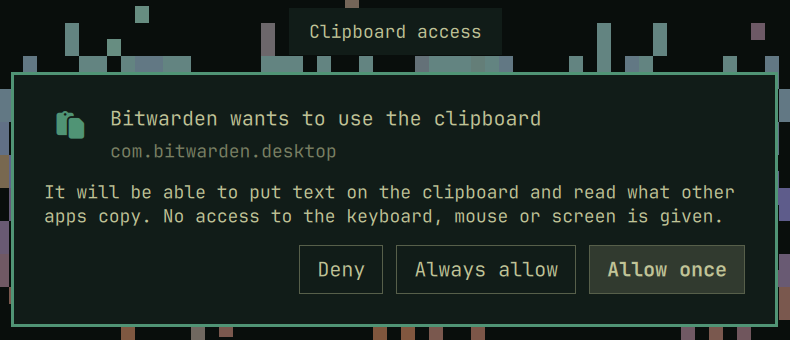

# xdg-desktop-portal-omarchy

An [xdg-desktop-portal](https://github.com/flatpak/xdg-desktop-portal) backend
for [Omarchy](https://omarchy.org) (Hyprland) that gives sandboxed apps the
clipboard the way GNOME does: through the **Clipboard** portal on a
**RemoteDesktop** session, after asking the user in an omarchy-shell dialog.

It grants the clipboard and nothing else. Sessions never get input devices
(`devices: 0`), the input-injection methods aren't implemented, and there is
no screen sharing.



## Why

Hyprland hides the data-control protocols (`ext_data_control_manager_v1`,
`zwlr_data_control_manager_v1`) from every client of Flatpak's
security-context socket (`CProtocolManager::isGlobalPrivileged`, not
configurable). Apps that copy without a focused window of their own — the
Bitwarden desktop app copies passwords through arboard — then fall back to
X11, which only reaches Wayland apps while an XWayland window has focus, so
pasting does nothing. Bitwarden already uses the Clipboard portal on GNOME;
xdg-desktop-portal-hyprland (1.4) implements neither RemoteDesktop nor
Clipboard. This backend implements both, only as far as the clipboard goes,
next to xdph.

For Bitwarden itself, also take X11 away from the Flatpak
(`flatpak override --nosocket=x11 com.bitwarden.desktop`): arboard only turns
to the portal when both data-control and X11 fail.

## How it works

- **Consent**: Start shows a dialog through the `lbssousa.portal` shell
  plugin: *Deny*, *Allow once* or *Always allow*. "Always" returns a
  `restore_data` that the frontend keeps in its permission store; the app's
  next sessions present the matching restore token and skip the dialog. No
  shell, no socket, a socket of another user or no answer within two minutes
  all mean *Deny*. The dialog grabs the keyboard when it appears, so allowing
  (by Enter or a click) only counts after half a second: a keystroke meant
  for another window can't grant access unread. Escape denies at once.
- **Ownership**: an app's `SetSelection` becomes an ext-data-control source
  offering its MIME types, owned by this backend on the seat's clipboard.
- **Cache**: the first time a type is requested, the app is asked once
  (`SelectionTransfer`); what it writes serves that reader and every later
  one, until another selection replaces it. Bitwarden answers a single
  transfer and then closes its session, while clipboard watchers
  (`wl-paste --watch`, behind Omarchy's clipboard history) read every new
  selection immediately, so without the cache the watcher would use up the
  password before the user pastes. The content outlives the session for the
  same reason. It is locked in RAM (best effort) and zeroed when replaced.
- **Passwords**: apps listed in `sensitive_apps` also offer
  `x-kde-passwordManagerHint` = `secret`, which clipboard histories skip.
- **Callers**: only the frontend (the owner of
  `org.freedesktop.portal.Desktop`) may call the backend.
- **Languages**: the dialog follows the language picked under
  *Setup > Language*, with a catalog for each language the shell ships
  (`plugin/i18n/`, missing strings fall back to English), mirrored for
  right-to-left ones. The app's name is the desktop entry's `Name[locale]`
  for that language when it has one.

## Installing

Arch: `cd packaging && makepkg -si`. The package installs the backend
(`/usr/lib/xdg-desktop-portal-omarchy`, D-Bus activated through
`xdg-desktop-portal-omarchy.service`), `omarchy.portal` and the shell plugin
in `/usr/share/xdg-desktop-portal-omarchy/plugin`. Then, per user:

```ini
# ~/.config/xdg-desktop-portal/hyprland-portals.conf, [preferred]
org.freedesktop.impl.portal.RemoteDesktop=omarchy
org.freedesktop.impl.portal.Clipboard=omarchy
```

```sh
systemctl --user restart xdg-desktop-portal
ln -sfn /usr/share/xdg-desktop-portal-omarchy/plugin ~/.config/omarchy/plugins/lbssousa.portal
omarchy-shell shell enablePlugin lbssousa.portal '{}'
```

`/etc/xdg/xdg-desktop-portal-omarchy/config.toml` (see `data/config.toml`):

```toml
sensitive_apps = ["com.bitwarden.desktop"]
```

`RUST_LOG=debug` (e.g. in a drop-in for the user unit) logs every transfer.

## Development

```sh
just test          # unit tests, rustfmt, clippy
just test-session  # end to end on a private bus, against this Wayland session
just dev [lang]    # the dialog in a separate Quickshell instance; `just try` asks it
just pkg           # the Arch package
```

## License

MIT
